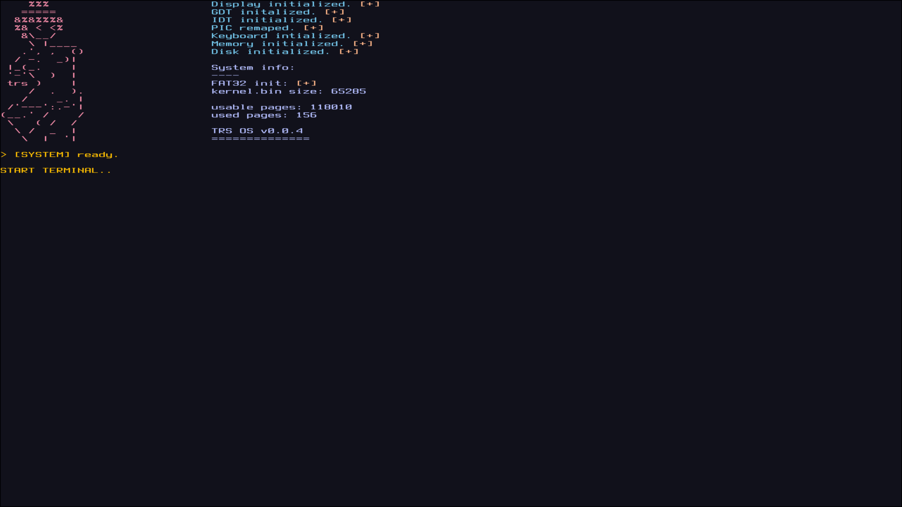

# TRS

<h3>& >> TSEZAR RELIABLE SYSTEM << &</h3>

<p>TRS __DOS__ это учебная 64-битная операционная система, написанная на чистом(<strong>ffreestanding</strong>) C и NASM. TRS ставит приоритетом надёжность, гибкость и ясность для пользователя, что и как происходит с его системой.</p>

## Планы на ОС:
- Полная прозрачность для пользователя без потери безопасности
- Работа ядра с процессами по жесткому контракту(ядро ограничивает процессу доступ к данным, памяти, CPU и проч. процесс должен изначально "попросить" у системы нужные ему ресурсы)
- Ядро будет стараться поддерживать "жизнь" системы. Предупреждая пользователя и убивая не приоритетные процессы, освобождая память и оптимизируя работу
- Дампинг памяти процессов в специальный раздел на диске для ввостановления и возможности понять, где именно произошла ошибка. 

$ Текущая версия: **0.0.4**



## Структура проекта

```
TRS/
├── bootloader/   # текущий загрузчик - UEFI
├── kernel/       # ядро
├── libc/         # freestanding-библиотека: mem, string, mutex
├── terminal/     # терминал (в разработке)
├── trfs/         # файловая система (в разработке)
└── Makefile      # сборка, запуск и отладка
```
**Реализовано:**
- Текстовый вывод на GOP framebuffer 
- Таблица прерываний IDT и контроллер PIC
- Драйвер PS/2-клавиатуры
- Система потоков ввода-вывода на ring buffer 
- Мини-libc: `memset` / `memcpy` / `strlen` и др.
- Panic-screen с выводом ошибки и регистров
- GDT (NULL, KernelCode, KernelData, UserCode, UserData)
- FAT32 & DISK драйверы

**Разметка диска:**
```
space/--system/     ; файлы системы
      --user/       ; файлы пользователя
dump/               ; дамп процессов
sand/               ; изолированная среда
```
---

## Инструкции по установке пакетов

### Для Ubuntu / Debian
```bash
sudo apt update
sudo apt install build-essential nasm gnu-efi ovmf parted dosfstools mtools qemu-system-x86
```

### Для Arch Linux
```bash
sudo pacman -Syu --needed base-devel nasm gnu-efi ovmf parted dosfstools mtools qemu-desktop
```

### Для Fedora
```bash
sudo dnf groupinstall "Development Tools"
sudo dnf install nasm gnu-efi edk2-ovmf parted dosfstools mtools qemu-kvm
```

## Дополнение:
### [FAT32](https://github.com/strawberryhacker/fat32.git) взят у strawberryhacker 