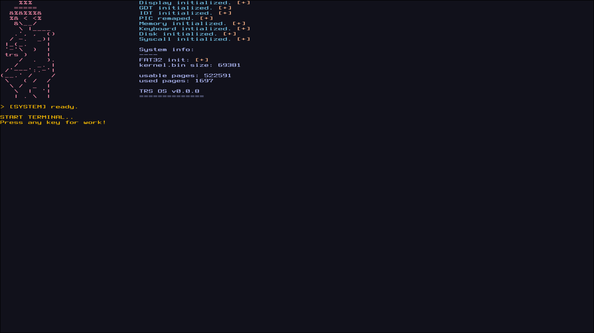

# TRS
# **== TSEZAR RELIABLE SYSTEM ==**


$ Текущая версия: **0.0.8**


# O CИСТЕМЕ

- SOON 


## Структура проекта

```
TRS/
├── bootloader/   # текущий загрузчик - UEFI
├── kernel/       # ядро и драйвера
├── libc/         # freestanding-библиотека: mem, string, mutex
├── terminal/     # терминал 
├── trfs/         # файловая система
├── base/         # базовые программы
└── Makefile      # сборка, запуск и отладка
```

**Разметка диска:**
```
space/--system/     ; файлы системы
      --user/       ; файлы пользователя
dump/               ; дамп процессов
sand/               ; изолированная среда
```
---

## Инструкции по установке пакетов

### Для Ubuntu / Debian
```bash
sudo apt update
sudo apt install build-essential nasm gnu-efi ovmf parted dosfstools mtools qemu-system-x86
```

### Для Arch Linux
```bash
sudo pacman -Syu --needed base-devel nasm gnu-efi ovmf parted dosfstools mtools qemu-desktop
```

### Для Fedora
```bash
sudo dnf groupinstall "Development Tools"
sudo dnf install nasm gnu-efi edk2-ovmf parted dosfstools mtools qemu-kvm
```

## Дополнение:
### [FAT32](https://github.com/strawberryhacker/fat32.git) взят у strawberryhacker 