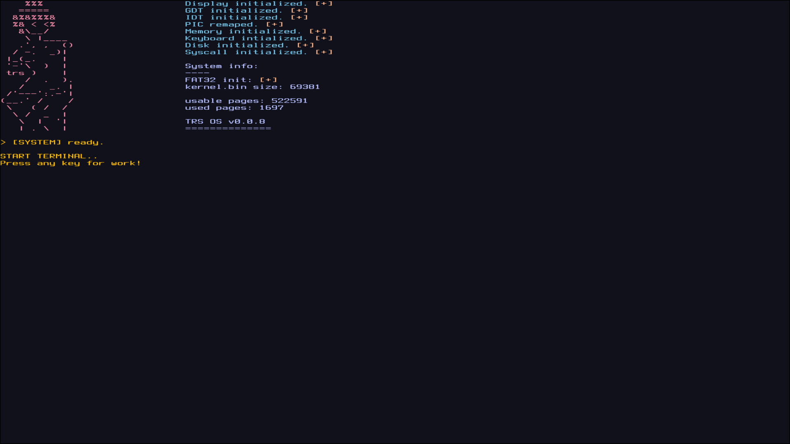

# TRS -- TSEZAR RELIBALE SYSTEM

### 64-битная операционная система.


$ Текущая версия: **0.1.0**


# O CИСТЕМЕ

TRS -- ОС для x86-64(пока что):

## Структура проекта


```
TRS/
├── bootloader/uefi/   # UEFI-загрузчик (boot.c, tramp.asm)
├── kernel/            # ядро, драйвера, обработка прерываний и syscall
│   ├── cpu/           # GDT, IDT, PIC
│   ├── driver/        # диск, GPT, FAT32, клавиатура, изображения
│   └── inc/           # заголовки ядра
├── libc/              # freestanding-библиотека: mem, string, stdio, mutex, dirent
├── terminal/          # терминал (term.pro)
├── trfs/fat32/        # драйвер FAT32
├── base/univ/         # базовые пользовательские программы (univ.pro)
├── ter-v32b.psf       # шрифт Terminus, встраивается в ядро
└── Makefile           # сборка, создание образа диска, запуск и отладка
```


## Разметка диска

Образ `build/trs.img` — GPT-диск с одним FAT32 ESP-разделом:

```
/EFI/BOOT/BOOTX64.EFI      # загрузчик
/space/sys/kern/kernel.bin # ядро
/space/sys/term.pro        # терминал
/space/user/univ.pro       # пользовательская программа
/dump/                     # дампы процессов
/sand/                     # изолированная среда
```
---

## Сборка и запуск

```bash
make            # полная сборка и создание build/trs.img (то же, что make disk)
make run        # запуск в QEMU с OVMF
make debug      # QEMU с gdb-стабом (-s -S)
make log        # запуск с логированием в serial.log и qemu.log
make clean      # удалить build/
```

Отдельные цели:

```bash
make boot       # build/BOOTX64.EFI
make kernel     # build/kernel.bin
make term       # build/term.pro
make univ       # build/univ.pro
```

### Для Ubuntu / Debian
```bash
sudo apt update
sudo apt install build-essential nasm gnu-efi ovmf parted dosfstools mtools qemu-system-x86
```

### Для Arch Linux
```bash
sudo pacman -Syu --needed base-devel nasm gnu-efi ovmf parted dosfstools mtools qemu-desktop
```

### Для Fedora
```bash
sudo dnf groupinstall "Development Tools"
sudo dnf install nasm gnu-efi edk2-ovmf parted dosfstools mtools qemu-kvm
```

## Syscall API

Пользовательские программы вызывают прерывание `0x77`:

| Номер | Имя                | Назначение                  |
|-------|--------------------|-----------------------------|
| 1     | **SYS_WRITE**      | вывод                       |
| 2     | **SYS_READ**       | ввод                        |
| 3     | **SYS_CLI_CLEAR**  | очистка экрана              |
| 4     | **SYS_SET_COL**    | установка цвета             |
| 5     | **SYS_SET_CRSR**   | позиция курсора             |
| 6     | **SYS_OPENDIR**    | открыть каталог             |
| 7     | **SYS_CLOSEDIR**   | закрыть каталог             |
| 8     | **SYS_READDIR**    | чтение каталога             |
| 9     | **SYS_DELAY**      | задержка                    |
| 10    | **SYS_START_PROC** | запуск процесса             |
| 11    | **SYS_FRAME_FLIP** | переключение кадра          |

## Дополнение:
### [FAT32](https://github.com/strawberryhacker/fat32.git) взят у strawberryhacker 